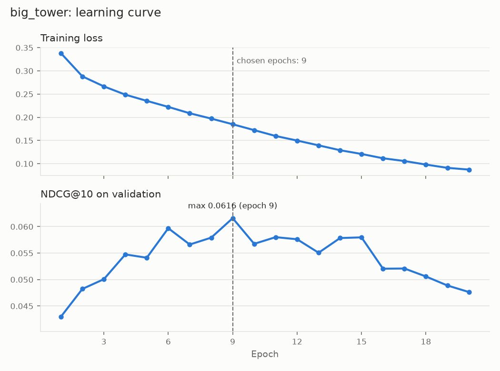

# big_tower

Optimized on 2026-11-09T15:59 with 30 Optuna (TPE) trials, maximizing NDCG@10 on validation.

## Result

| Metric | Value |
|---|---|
| NDCG@10 on test | **0.0664** |
| NDCG@10 on validation (the one Optuna maximized) | 0.0616 |
| NDCG@10 of popularity on test (reference) | 0.0440 |
| Universe users the model knows (test) | 99.6% |
| Albums in the model (test) | 1330 |
| Time per trial | 11 s |
| Final model: reviews / users / albums | 35441 / 2298 / 1628 |

## Chosen hyperparameters

| Hyperparameter | Value |
|---|---|
| min_album | 6 |
| positive_rating | 2.5 |
| negatives | 7 |
| learning_rate | 0.003701 |
| epochs | 9 |

## Importance of each hyperparameter (fANOVA)

| Hyperparameter | Importance |
|---|---|
| negatives | 0.42 |
| epochs | 0.29 |
| min_album | 0.16 |
| positive_rating | 0.11 |
| learning_rate | 0.02 |

## Best trials

| # | NDCG@10 (validation) | min_album | positive_rating | negatives | learning_rate | epochs |
|---|---|---|---|---|---|---|
| 26 | 0.0616 | 6 | 2.5 | 7 | 0.003701 | 9 |
| 14 | 0.0599 | 3 | 3 | 6 | 0.0005594 | 7 |
| 29 | 0.0591 | 3 | 2 | 6 | 0.004013 | 9 |
| 21 | 0.0585 | 5 | 1.5 | 10 | 0.002681 | 12 |
| 25 | 0.0584 | 9 | 1.5 | 9 | 0.005231 | 14 |
| 11 | 0.0582 | 7 | 2.5 | 8 | 0.001294 | 12 |
| 20 | 0.0578 | 5 | 3 | 9 | 0.003205 | 11 |
| 23 | 0.0572 | 3 | 1.5 | 10 | 0.004648 | 11 |
| 18 | 0.0555 | 14 | 1 | 8 | 0.002258 | 13 |
| 28 | 0.0550 | 3 | 1.5 | 10 | 0.001211 | 14 |

## Learning curve

With the chosen hyperparameters, trained on train for more epochs than the chosen ones (9, dashed line).

| Epoch | Loss | NDCG@10 (validation) |
|---|---|---|
| 1 | 0.3382 | 0.0430 |
| 2 | 0.2881 | 0.0482 |
| 3 | 0.2666 | 0.0501 |
| 4 | 0.2488 | 0.0548 |
| 5 | 0.2354 | 0.0541 |
| 6 | 0.2224 | 0.0597 |
| 7 | 0.2087 | 0.0566 |
| 8 | 0.1972 | 0.0579 |
| 9 | 0.1850 | 0.0616 |
| 10 | 0.1723 | 0.0567 |
| 11 | 0.1597 | 0.0580 |
| 12 | 0.1498 | 0.0576 |
| 13 | 0.1395 | 0.0551 |
| 14 | 0.1290 | 0.0578 |
| 15 | 0.1210 | 0.0580 |
| 16 | 0.1117 | 0.0521 |
| 17 | 0.1057 | 0.0521 |
| 18 | 0.0981 | 0.0506 |
| 19 | 0.0910 | 0.0489 |
| 20 | 0.0873 | 0.0476 |
