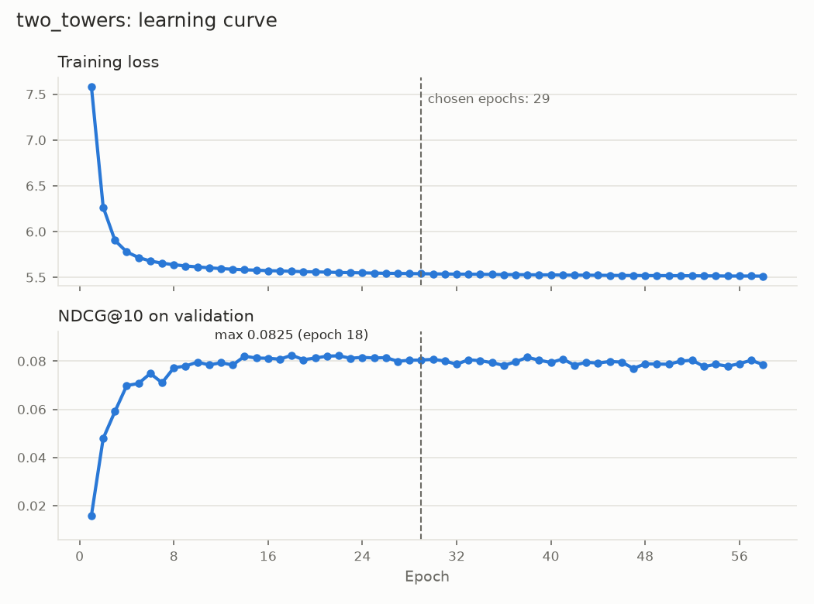

# two_towers

Optimized on 2026-11-09T15:52 with 49 Optuna (TPE) trials, maximizing NDCG@10 on validation.

## Result

| Metric | Value |
|---|---|
| NDCG@10 on test | **0.0716** |
| NDCG@10 on validation (the one Optuna maximized) | 0.0804 |
| NDCG@10 of popularity on test (reference) | 0.0440 |
| Universe users the model knows (test) | 100.0% |
| Albums in the model (test) | 2656 |
| Time per trial | 3 s |
| Final model: reviews / users / albums | 39848 / 2301 / 3035 |

## Chosen hyperparameters

| Hyperparameter | Value |
|---|---|
| min_album | 2 |
| positive_rating | 1 |
| dim | 32 |
| temperature | 0.2349 |
| learning_rate | 0.02373 |
| epochs | 29 |
| attributes | False |

## Importance of each hyperparameter (fANOVA)

| Hyperparameter | Importance |
|---|---|
| positive_rating | 0.40 |
| temperature | 0.32 |
| epochs | 0.11 |
| learning_rate | 0.09 |
| dim | 0.06 |
| min_album | 0.02 |
| attributes | 0.00 |

## Best trials

| # | NDCG@10 (validation) | min_album | positive_rating | dim | temperature | learning_rate | epochs | attributes |
|---|---|---|---|---|---|---|---|---|
| 23 | 0.0804 | 2 | 1 | 32 | 0.2349 | 0.02373 | 29 | False |
| 40 | 0.0804 | 1 | 0.5 | 32 | 0.1917 | 0.01818 | 29 | False |
| 24 | 0.0797 | 1 | 1 | 64 | 0.1939 | 0.04615 | 23 | False |
| 37 | 0.0796 | 1 | 1 | 32 | 0.1669 | 0.04534 | 27 | False |
| 29 | 0.0787 | 2 | 1 | 32 | 0.1574 | 0.01362 | 27 | False |
| 27 | 0.0786 | 1 | 1 | 64 | 0.2518 | 0.03592 | 24 | False |
| 34 | 0.0785 | 1 | 0.5 | 64 | 0.1433 | 0.02089 | 18 | False |
| 26 | 0.0784 | 1 | 1 | 64 | 0.2456 | 0.02915 | 21 | False |
| 43 | 0.0782 | 2 | 0.5 | 32 | 0.2485 | 0.0187 | 27 | True |
| 21 | 0.0781 | 2 | 1.5 | 64 | 0.2172 | 0.0271 | 29 | False |

## Learning curve

With the chosen hyperparameters, trained on train for more epochs than the chosen ones (29, dashed line).

| Epoch | Loss | NDCG@10 (validation) |
|---|---|---|
| 1 | 7.5838 | 0.0159 |
| 2 | 6.2666 | 0.0479 |
| 3 | 5.9034 | 0.0591 |
| 4 | 5.7777 | 0.0698 |
| 5 | 5.7168 | 0.0707 |
| 6 | 5.6787 | 0.0749 |
| 7 | 5.6549 | 0.0710 |
| 8 | 5.6381 | 0.0772 |
| 9 | 5.6241 | 0.0779 |
| 10 | 5.6139 | 0.0796 |
| 11 | 5.6045 | 0.0784 |
| 12 | 5.5955 | 0.0793 |
| 13 | 5.5887 | 0.0784 |
| 14 | 5.5827 | 0.0820 |
| 15 | 5.5782 | 0.0813 |
| 16 | 5.5731 | 0.0812 |
| 17 | 5.5703 | 0.0808 |
| 18 | 5.5663 | 0.0825 |
| 19 | 5.5615 | 0.0806 |
| 20 | 5.5597 | 0.0812 |
| 21 | 5.5570 | 0.0821 |
| 22 | 5.5532 | 0.0822 |
| 23 | 5.5519 | 0.0812 |
| 24 | 5.5491 | 0.0815 |
| 25 | 5.5469 | 0.0813 |
| 26 | 5.5444 | 0.0814 |
| 27 | 5.5431 | 0.0799 |
| 28 | 5.5417 | 0.0803 |
| 29 | 5.5401 | 0.0804 |
| 30 | 5.5380 | 0.0807 |
| 31 | 5.5368 | 0.0801 |
| 32 | 5.5349 | 0.0787 |
| 33 | 5.5344 | 0.0806 |
| 34 | 5.5334 | 0.0801 |
| 35 | 5.5316 | 0.0793 |
| 36 | 5.5300 | 0.0782 |
| 37 | 5.5297 | 0.0797 |
| 38 | 5.5285 | 0.0815 |
| 39 | 5.5270 | 0.0804 |
| 40 | 5.5273 | 0.0794 |
| 41 | 5.5251 | 0.0809 |
| 42 | 5.5241 | 0.0783 |
| 43 | 5.5240 | 0.0795 |
| 44 | 5.5228 | 0.0792 |
| 45 | 5.5216 | 0.0798 |
| 46 | 5.5206 | 0.0796 |
| 47 | 5.5205 | 0.0770 |
| 48 | 5.5198 | 0.0788 |
| 49 | 5.5190 | 0.0788 |
| 50 | 5.5191 | 0.0787 |
| 51 | 5.5179 | 0.0800 |
| 52 | 5.5177 | 0.0804 |
| 53 | 5.5164 | 0.0777 |
| 54 | 5.5162 | 0.0787 |
| 55 | 5.5144 | 0.0779 |
| 56 | 5.5149 | 0.0789 |
| 57 | 5.5145 | 0.0803 |
| 58 | 5.5136 | 0.0785 |
